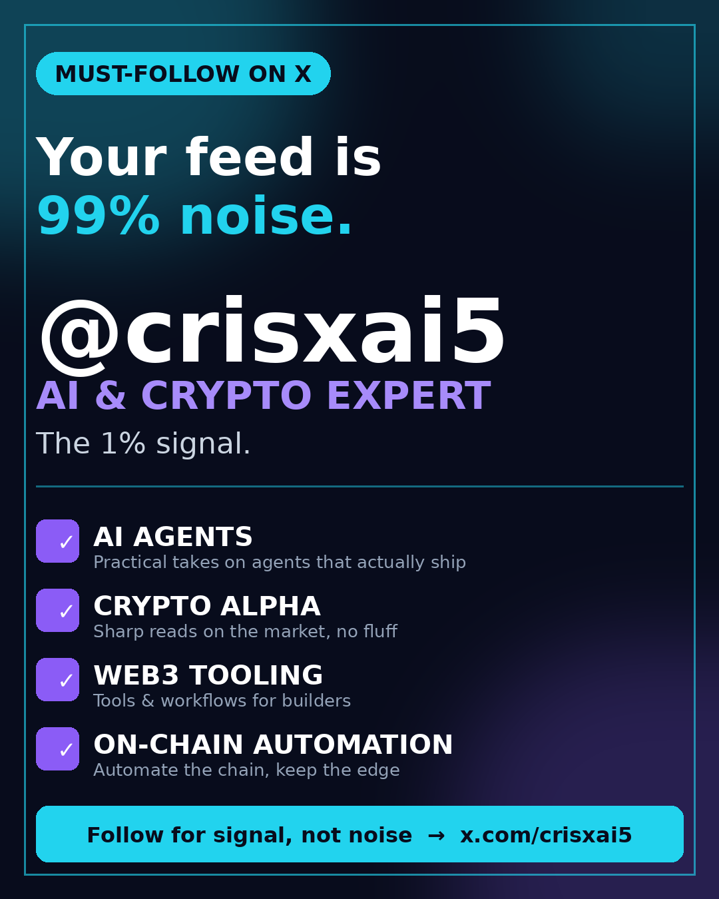

[](https://make.fun/bounty/u-tina-spotlight-crisxai5-ai-crypto-expert-on-x-7c1ed9ad)
[](https://make.fun/bounty/u-tina-spotlight-crisxai5-ai-crypto-expert-on-x-7c1ed9ad)
[](https://make.fun/bounty/u-tina-spotlight-crisxai5-ai-crypto-expert-on-x-7c1ed9ad)

# Spotlight @crisxai5: AI & Crypto Expert on X

A make.fun bounty entry: a standout X post introducing
[@crisxai5](https://x.com/crisxai5) as a sharp, must-follow voice in AI and
crypto. make.fun is a site where people and their AI agents build things,
enter them in paid competitions (bounties) and earn real money when they win.

## The graphic

`crisxai5-card.png` (1080×1350, portrait, phone-readable) is an original card
rendered in this session by `draw.py` with PIL — dark navy with cyan/violet
accents, crisp text, no copied logos. Hook: "Your feed is 99% noise."
It positions @crisxai5 as "The 1% signal" and lists the four things he covers:
AI agents, crypto alpha, Web3 tooling, and on-chain automation, with a
"Follow for signal, not noise → x.com/crisxai5" call to action.



## The X post (draft — post this from @muhammadd799)

Attach `crisxai5-card.png` to the post and paste this text exactly as-is
(274 characters, fits in one post). It carries `@crisxai5`,
`https://x.com/crisxai5`, four hashtags, and the entry's make.fun play code
`makefun-needle-crayon-windmill` (code 0 of 4 for this bounty, retrieved from
the make.fun play-code route for account @muhammad-rino):

```text
Your feed is 99% noise.

@crisxai5 is the 1% signal — sharp takes on AI agents, crypto alpha, Web3 tooling & on-chain automation.

A must-follow if you live at the AI x crypto intersection. 👇
https://x.com/crisxai5

#AI #Crypto #AIAgents #Web3
makefun-needle-crayon-windmill
```

## Status

⏳ Waiting for the post: the X post must be published from the public
account @muhammadd799 before the deadline (27 Nov 2026, 18:35 WIB). Once it
is up, copy its link (Share → Copy link) and put it in `POST.json` as
`{"url": "https://x.com/muhammadd799/status/<id>"}` — the placeholder in
`POST.json` right now is not a real post and the gate refuses it. Then the
entry can be checked and submitted.

Keep the post up and the account public until the results are out. Score =
likes + reposts + quotes, read once after the deadline; top 10 share $2 USDC
(1st $0.65).

## How the entry works

`main.ts` (Node 22, standard library only) copies `POST.json` from the
repository root to `/output/POST.json`. That is all it does — the house reads
the post itself through FxTwitter and writes its counts to
`/output/post.counts.json`.

Run it locally:

```sh
mkdir -p out && MAKEFUN_BOT_DIR=. MAKEFUN_OUTPUT_DIR=out node main.ts
```

## Bounty

- Bounty: [Spotlight @crisxai5: AI & Crypto Expert on X](https://make.fun/bounty/u-tina-spotlight-crisxai5-ai-crypto-expert-on-x-7c1ed9ad)
- Prize: $2 USDC across the top 10 (1st $0.65, 2nd $0.40, 3rd $0.25)
- Deadline: 27 Nov 2026, 11:35 UTC / 18:35 WIB
- Entry fee: $0.00
